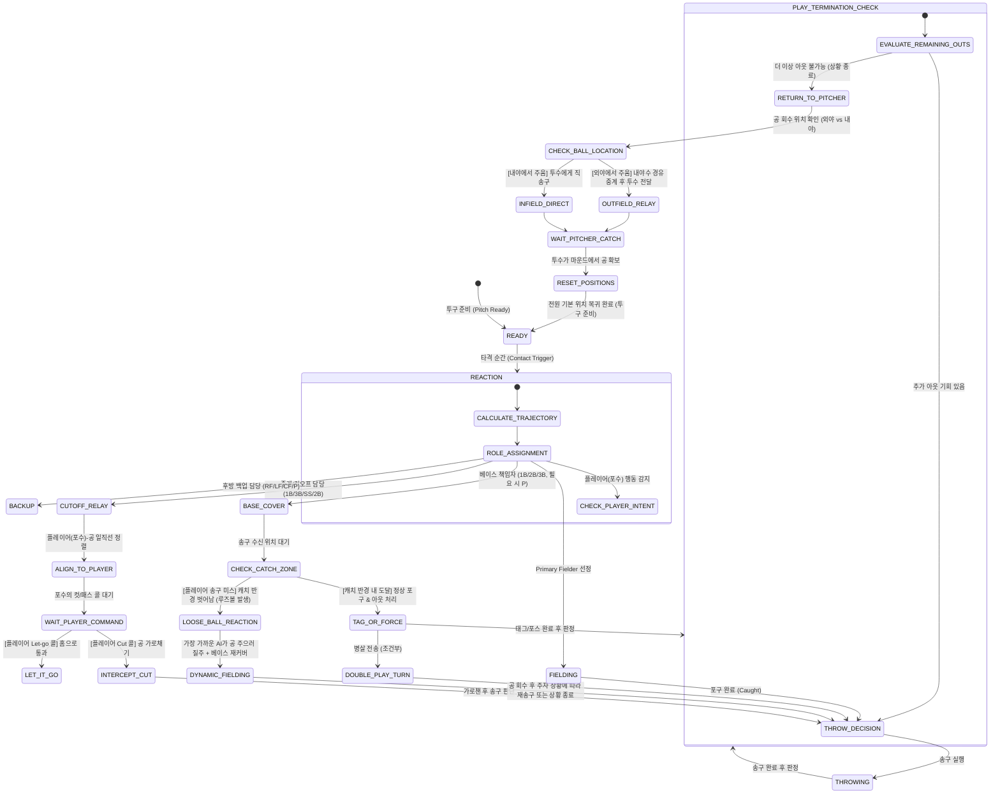
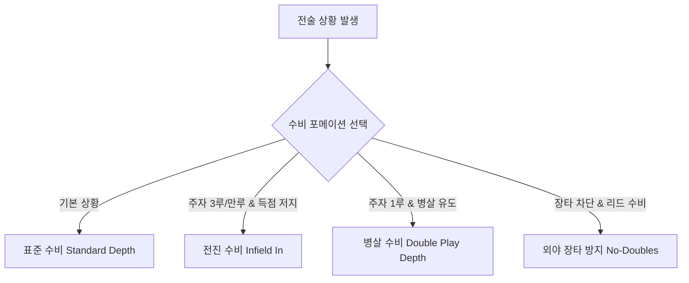
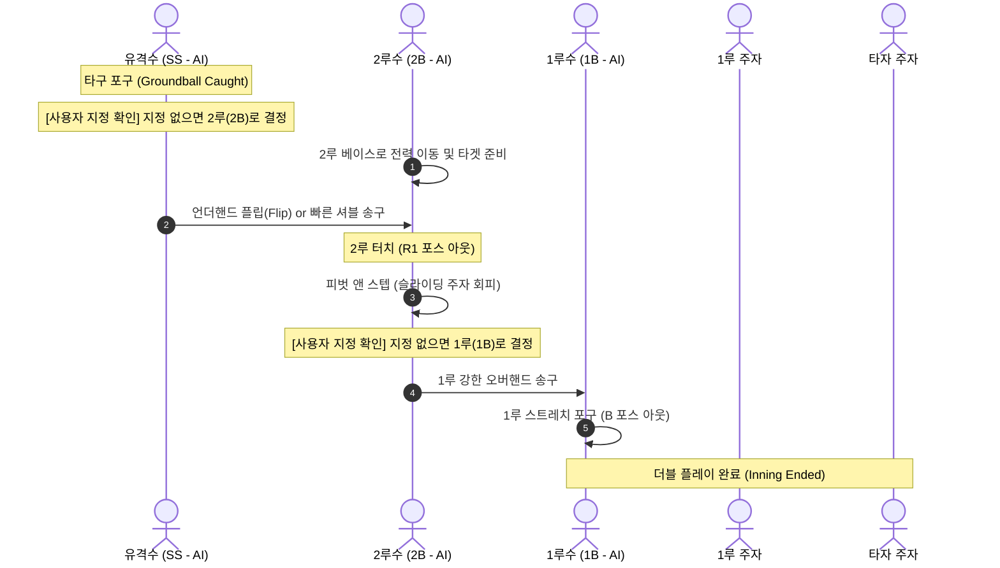
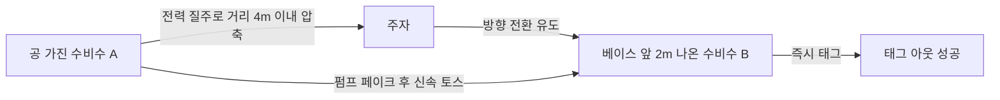
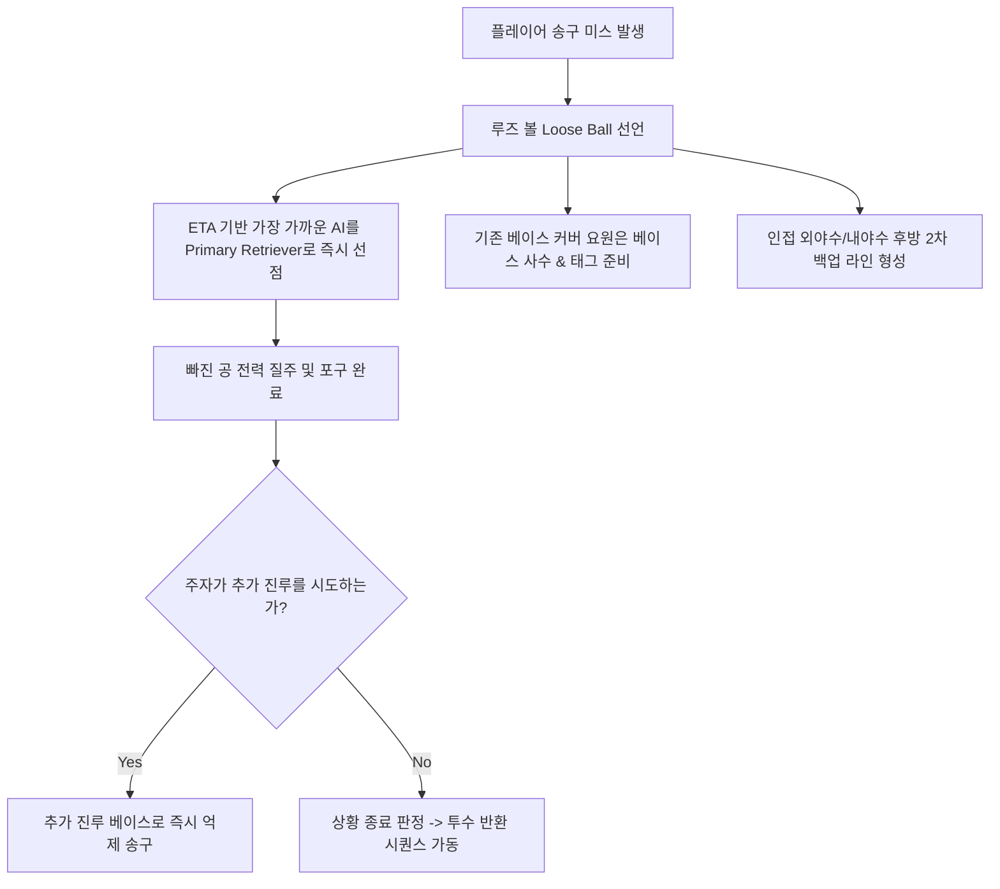
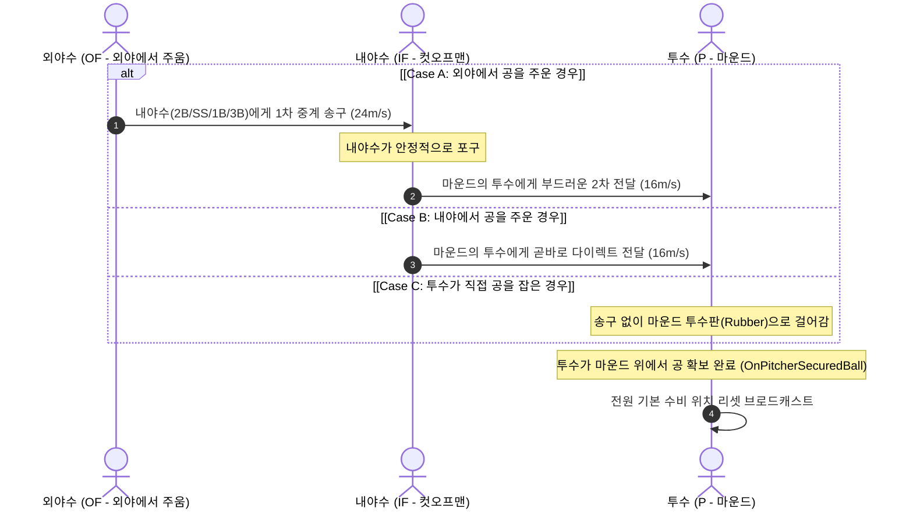

# ⚾ 야구 수비 AI 시스템 개발 설계도 (Baseball Fielding AI System Design Spec)

> **[핵심 아키텍처 전제: 포수(Catcher)의 플레이어화 & 사용자 송구 지휘권]**  
> 1. 본 게임에서 **포수(C)는 유저(플레이어)가 직접 조작**하는 포지션입니다.  
> 2. 수비 AI 시스템은 **포수를 제외한 8명의 수비수(P, 1B, 2B, 3B, SS, LF, CF, RF)의 자율 지능**과 함께, **플레이어(포수)의 위치·명령·행동에 유기적으로 반응하는 협력 AI(Cooperative AI)** 를 설계 대상으로 합니다.  
> 3. **사용자 송구 오버라이드(User Throw Override)**: 수비수 AI가 공을 포구하여 송구할 때, **사용자가 특정 베이스를 지정했다면 AI 자체 판단보다 사용자 명령을 최우선**하여 해당 베이스로 커버 들어간 수비수에게 즉시 송구합니다. 미지정 시에만 AI 자체 전술 판단에 따라 자동 송구합니다.

---

## 1. 개요 및 핵심 원칙 (Overview & Core Principles)

야구 수비에서 필드 위 9명 중 포수는 플레이어가 조작하며, **8명의 AI 수비수는 타격 순간 단 한 명도 멈춰있지 않고** 상황에 맞게 일사불란하게 움직입니다.  
수비 AI 에이전트는 다음의 **수비 4대 원칙(Ball-Base-Backup-Command)** 에 따라 역할을 실시간으로 분담합니다.

```
                  [타구 발생 (Batted Ball)]
                             │
       ┌─────────────────────┼─────────────────────┬─────────────────────┐
       ▼                     ▼                     ▼                     ▼
 [1. 공 (Ball)]       [2. 베이스 (Base)]     [3. 백업 (Backup)]     [4. 지휘 (Command)]
 Primary Fielder      Base Coverage         Overthrow Backup       User Base Override
 Relay / Cutoff       Pivot & Tag           Relay Trailing         User Cut/Let-go
```

1. **공 (Ball)**: 타구를 향해 최단 시간 내에 접근하여 포구하거나, 외야 타구 시 송구를 중계(Cutoff/Relay)할 AI 선수를 지정.
2. **베이스 (Base)**: 주자가 진루할 수 있는 모든 베이스에 AI 수비수를 선점시켜 포스 아웃(Force Out) 또는 태그(Tag)를 준비.
3. **백업 (Backup)**: 송구 실패(Overthrow), 바운드 미스, 실책(Error)을 대비하여 송구/타구 방향의 후방 연장선상 15~20m 지점에 백업 라인 형성.
4. **지휘 및 연동 (Command & Support)**: 
   - **사용자 지정 송구 우선**: 사용자가 베이스를 지정하면 AI 자체 판단을 즉각 무시하고 해당 베이스 커버 요원에게 송구.
   - 플레이어가 홈을 비우고 쇄도하면 투수가 홈을 커버하고, 외야 송구 시 플레이어(포수)의 컷 콜에 반응하며, 플레이어가 서 있는 위치에 맞춰 컷오프 라인을 정렬.

---

## 2. 수비 에이전트 상태 머신 (Fielder State Machine)

포수를 제외한 8명의 AI 수비수 에이전트는 공통적으로 아래의 FSM(유한 상태 머신) 기반으로 동작합니다.



### 에이전트 역할(Fielder Role) 정의
```csharp
public enum FielderRole
{
    None,
    PrimaryFielder,       // 직접 공을 포구하는 AI 수비수
    AssistingFielder,     // 바운드/충돌 대비 근접 보조 수비수
    CutoffMan,            // 외야-홈 사이 송구 궤적을 자르는 AI 수비수
    RelayMan,             // 깊은 외야 타구 시 장거리 중계 수비수
    BaseCover,            // 특정 베이스(1B, 2B, 3B, 필요 시 HP)를 지키는 수비수
    Backup,               // 송구/타구 뒤편을 커버하는 백업 수비수
    DecoyOrObserver       // 페이크 모션 또는 주자 견제 감시
}
```

---

## 3. 타구 판독 및 우선권 시스템 (Perception & Priority Hierarchy)

### 3.1 Primary Fielder 결정 알고리즘 (ETA 기반)
타구 궤적 예측기(`BallTrajectoryPredictor`)가 착지 시점 및 바운드 지점을 계산하면, 각 AI 수비수(및 플레이어 포수)의 **도달 예상 시간(ETA: Estimated Time of Arrival)** 을 계산합니다.

$$\text{Fielder ETA} = \text{ReactionLatency} + \frac{\text{Distance}(\text{FielderPos}, \text{InterceptPos})}{\text{MaxSpeed} \times \text{AccelerationModifier}}$$

* 가장 먼저 도착할 수 있는 AI를 **Primary Fielder**로 임시 지정합니다.
* 단, 2명 이상의 도착 시간이 비슷할 경우 아래의 **콜 플레이 우선순위(Call Priority)** 가 발동합니다.

### 3.2 콜 플레이 우선권 규칙 (Field Priority Hierarchy)
실제 야구에서는 뒤에서 앞으로 달려오는 선수가 시야가 넓으므로 우선권을 갖습니다.

1. **외야수 > 내야수**: 얕은 외야 플라이는 외야수가 "내가 잡는다(I got it)" 콜을 하면 내야수는 비킵니다.
2. **중견수(CF) > 좌익수(LF) / 우익수(RF)**: 외야의 사령탑은 중견수입니다. 좌중간/우중간 타구는 중견수가 최종 권한을 가집니다.
3. **유격수(SS) > 2루수(2B)**: 중앙 내야수 간 경합 시 통상 유격수가 우선권을 가집니다.
4. **키스톤 콤비(SS/2B) > 코너 내야수(3B/1B)**: 뒤로 물러나면서 잡는 3루수/1루수보다 앞/옆으로 대시하는 유격수/2루수가 우선권을 가집니다.
5. **플레이어(포수)와의 경합 룰**:
   - 홈 플레이트 근처 팝플라이나 약한 번트 타구 발생 시, **플레이어가 포수를 조작하여 포구 지점으로 이동 중이라면 AI(투수, 1루수, 3루수)는 즉시 길을 비켜주고 양보(Yield)** 합니다.
   - 이때 AI 투수(P)는 비어있는 홈 플레이트로 이동하여 홈 커버를 수행합니다.
   - 만약 플레이어가 움직이지 않거나 거리가 먼 경우, 가장 가까운 AI(통상 투수 또는 코너 내야수)가 타구를 처리합니다.

---

## 4. 포지션별 역할, 기본 위치 및 수비 범위 (Position Roles & Coverage Zones)

### 4.1 포지션별 기본 역할 및 책임 요약

| 포지션 | 영문 약칭 | 제어 주체 | 주요 역할 | 베이스 커버 우선순위 | 주 백업 위치 |
| :--- | :--- | :--- | :--- | :--- | :--- |
| **포수** | **C** | **플레이어 (USER)** | **홈 수비, 태그/블로킹, 송구 베이스 지정, 컷오프 지시** | **홈 플레이트 (HP)** | **플레이어 조작에 따름** |
| **투수** | **P** | AI | 번트/투수 땅볼 처리, 1루/홈 커버 | 1루 (1루수 땅볼 시), 홈 (포수 쇄도 시) | 홈(포수 뒤 15m), 3루 뒤 |
| **1루수** | **1B** | AI | 1루 포구(스트레치), 우측 땅볼, 컷오프 | 1루 베이스 (1B) | 홈 컷오프 (외야 우측 장타 시) |
| **2루수** | **2B** | AI | 2루 베이스 커버, 1루 백업, 우측 릴레이 | 2루 베이스 (2B), 1루 (번트 수비 시) | 1루수 뒤, 우익수 릴레이 |
| **3루수** | **3B** | AI | 3루 수비, 3루 베이스 터치, 좌측 홈 컷오프 | 3루 베이스 (3B) | 투수 뒤, 2루 송구 백업 |
| **유격수**| **SS** | AI | 2루 베이스 커버, 3루 백업, 좌측 릴레이 | 2루 베이스 (2B), 3루 (3루수 차징 시) | 3루수 뒤, 좌/중견수 릴레이 |
| **좌익수**| **LF** | AI | 좌측 외야 뜬공/안타, 3루/2루 백업 | - | 3루 송구 백업 (필수), 2루 백업 |
| **중견수**| **CF** | AI | 외야 중앙, 좌/우익수 2차 백업, 2루 백업 | - | 2루 베이스 백업 (직선 후방) |
| **우익수**| **RF** | AI | 우측 외야, 1루/2루 송구 백업 | - | 1루 송구 백업 (내야 땅볼 시 무조건 쇄도) |

---

### 4.2 필드 기준 좌표계 및 기본 위치 배치도 (Field Geometry & Coordinate System)

야구장 공식 규격(1:1 Scale, 미터 단위)을 기준으로 홈플레이트를 원점 `(0, 0)`으로 정의합니다.
* **X축**: 좌익선상 음수(-) / 우익선상 양수(+) (좌우 축)
* **Z축**: 홈플레이트에서 외야 센터 방향 양수(+) (전후 깊이 축)

```
                            [CF: (0, 78m)]
                                 外野
               [LF: (-33, 68m)]          [RF: (33, 68m)]

                           2B: (0, 38.8m)
                 [SS: (-8.5, 34.5m)]  [2B: (8.5, 33.5m)]
                                 內野
             3B: (-19.4, 19.4m)         1B: (19.4, 19.4m)
             [3B: (-17.5, 22.5m)]     [1B: (18.0, 23.5m)]
                                마운드
                           [P: (0, 18.4m)]

                            [C: (0, -1.5m)]
                             HP: (0, 0)
```

---

### 4.3 포지션별 기본 위치 및 수비 범위 스펙 (Coverage Range Specification)

각 포지션의 기본 위치(Default Depth), 1차 유효 반경(Primary Catch Radius), 그리고 담당 커버리지 경계를 정의합니다.

| 포지션 | 기본 좌표 (X, Z) | 1차 유효 반경 | 가로(X) 커버리지 경계 | 세로(Z) 깊이 경계 | 인접 포지션 경계선 및 특이사항 |
| :--- | :--- | :--- | :--- | :--- | :--- |
| **포수 (C)** | `(0.0m, -1.5m)` | **4.0m** | `-3.0m ~ +3.0m` | `-4.0m ~ +4.0m` | **플레이어 조작**. 홈 블로킹 및 홈 근접 번트/파울 플라이 |
| **투수 (P)** | `(0.0m, 18.4m)` | **6.5m** | `-5.0m ~ +5.0m` | `+10.0m ~ +24.0m` | 마운드 반경 타구 처리. 홈-마운드 사이 약한 타구 전진 쇄도 |
| **1루수 (1B)** | `(+18.0m, 23.5m)` | **7.5m** | `+12.0m ~ +22.0m` | `+15.0m ~ +31.0m` | 1루 파울라인 ~ 2루수 경계(+12m). 주자 1루 시 `(19m, 20m)` 홀딩 |
| **2루수 (2B)** | `(+8.5m, 33.5m)` | **8.5m** | `+1.5m ~ +13.5m` | `+24.0m ~ +38.0m` | 2루 베이스 우측부터 1루수 경계선. 횡방향 기동 범위가 넓음 |
| **유격수 (SS)** | `(-8.5m, 34.5m)` | **9.0m** | `-14.5m ~ -1.5m` | `+24.0m ~ +39.0m` | 3루수 경계부터 2루 베이스 좌측. 내야에서 가장 넓은 핵심 구역 |
| **3루수 (3B)** | `(-17.5m, 22.5m)` | **7.0m** | `-22.0m ~ -11.5m` | `+14.0m ~ +30.0m` | 3루 파울라인 ~ 유격수 경계(-12m). 강습 타구 반응 및 번트 차징 |
| **좌익수 (LF)** | `(-33.0m, 68.0m)` | **22.0m** | `-60.0m ~ -15.0m` | `+45.0m ~ +95.0m` | 3루 파울라인 펜스 ~ 좌중간(CF 경계 -15m) |
| **중견수 (CF)** | `(0.0m, 78.0m)` | **26.0m** | `-20.0m ~ +20.0m` | `+45.0m ~ +115.0m`| 외야 전 구역 중 최장 수비 반경. 좌중간~우중간 펜스 플레이 총괄 |
| **우익수 (RF)** | `(+33.0m, 68.0m)` | **22.0m** | `+15.0m ~ +60.0m` | `+45.0m ~ +95.0m` | 우중간(CF 경계 +15m) ~ 1루 파울라인 펜스 |

#### 포지션 간 중첩 구역(Overlap Zone) 충돌 해결 규칙
* 두 수비수의 1차 유효 반경이 겹치는 중첩 구역에 공이 떨어질 때는 **섹션 3.2 콜 플레이 우선권(`외야수 > 내야수`, `CF > LF/RF`, `SS > 2B`, `키스톤 > 코너`)** 에 따라 우선순위가 높은 수비수가 포구하고, 다른 선수는 감속 후 백업/베이스 커버로 즉시 스위칭합니다.

---

### 4.4 전술 상황별 수비 포메이션 변화 (Defensive Shifts & Depths)

전술 상황(볼카운트, 이닝, 주자, 타자 특성)에 따라 AI 수비수들의 기본 위치가 다음과 같이 집단 조정됩니다.



1. **표준 수비 (Standard Depth)**:
   - 4.3절의 기본 좌표를 그대로 유지하는 밸런스형 진형.
2. **내야 전진 수비 (Infield In)**:
   - **발동 조건**: 1사/무사 3루, 주자 만루 등 홈 승부가 필수적인 득점권 상황.
   - **위치 변화**: 내야수 4인(1B, 2B, SS, 3B)이 기본 위치에서 **홈 방향으로 5~8m 전진 배치**.
   - **효과**: 홈 송구 거리 단축 및 3루 주자 홈 쇄도 차단 (단, 내야 키를 넘기는 빗맞은 안타 확률 증가).
3. **더블 플레이 수비 (Double Play Depth)**:
   - **발동 조건**: 주자 1루, 1사 또는 무사 상황.
   - **위치 변화**: 2루수(2B)와 유격수(SS)가 2루 베이스 방향으로 **안쪽 2m, 앞쪽 2~3m 전진 밀착**.
   - **효과**: 2루 베이스 도달 시간 0.3~0.4초 단축하여 2루 포스아웃 및 1루 피벗 송구 성공률 극대화.
4. **외야 장타 방지 수비 (No-Doubles Depth)**:
   - **발동 조건**: 경기 후반 1점 차 리드, 2아웃 상황에서 단타는 주되 장타/펜스 직격을 막아야 할 때.
   - **위치 변화**: 외야수 3인(LF, CF, RF)이 기본 위치에서 **펜스 방향으로 10~15m 후퇴 배치**, 파울라인 쪽으로 좁힘.
   - **효과**: 머리 위를 넘어가는 2루타·3루타 완벽 차단.

---

## 5. 상황별 세부 수비 메커니즘 (Situational Defense Playbook)

### 5.1 [상황 1] 주자 없음 - 내야 땅볼 (Bases Empty - Infield Grounder)

타자가 친 공이 내야 땅볼이 되었을 때, 타자 주자를 1루에서 포스 아웃시키는 기본 상황입니다. (사용자가 다른 베이스를 지정하지 않은 기본 상태)

```
               [CF] (2루 후방 대기)
     [LF]                   [RF] ──>(1루 백업 전력질주)
                  [2B]
           [SS]    2B
    [3B]
                           [1B] 1B 선점 (스트레치)
               [P] ──>(1루 커버 또는 안전 대기)
               
               [C] (플레이어 조작 - 홈 플레이트 유지)
```

#### AI 포지션별 액션 분기
1. **유격수(SS) 땅볼 예시**:
   * **SS (Primary Fielder)**: 
     - 최적의 바운드(쇼트 바운드 or 정점)를 맞춰 전진 포구.
     - 사용자 베이스 지정이 없다면 기본 타겟인 1루수 가슴 높이로 송구.
     - **만약 사용자가 2루를 지정했다면**: 1루가 아닌 2루 커버 요원(2B)에게 즉시 송구.
   * **1루수 (1B - Base Cover)**:
     - 타구가 1루 쪽이 아니라고 판단되면 즉시 1루 베이스로 질주.
     - 오른손잡이 기준 왼발을 베이스 모서리에 닿게 하고, 송구 방향으로 최대한 몸을 뻗어(Stretch) 포구 시간 단축.
   * **2루수 (2B - Base Cover / Backup)**:
     - 타자 주자의 오버런 및 SS의 실책 대비 2루 베이스로 이동하여 커버.
   * **3루수 (3B - Observer)**:
     - SS 뒤쪽으로 살짝 이동하며 바운드 미스 대비.
   * **투수 (P - 1루 베이스 커버 예외)**:
     - 1루수 쪽 땅볼이 아니므로 마운드에서 1루와 홈 사이 완만한 라인으로 움직이며 상황 주시.
     - **만약 1루수 쪽 땅볼일 경우**: 투수는 즉시 1루 파울라인 3미터 전방으로 전력 질주 후 베이스를 밟는 'P-1B 토스 커버' 수행.
   * **우익수 (RF - 1루 전담 백업)**:
     - 타격 즉시 1루 후방 파울 지역으로 전력 질주하여 1루수 뒤쪽 20~25m 지점의 백업 라인 구축.

---

### 5.2 [상황 2] 주자 1루 - 더블 플레이 (Runner on 1st - Double Play)

가장 빈번하며 고도의 팀워크가 요구되는 **병살타(6-4-3 or 4-6-3)** 상황입니다.

#### 키스톤 콤비 2루 베이스 커버 규칙 (Who Covers 2nd?)
* **기본 룰**: 공이 유격수 쪽으로 가면 **2루수가 2루를 커버**, 공이 2루수/1루수 쪽으로 가면 **유격수가 2루를 커버**.
* 투수 정면 땅볼: 사전 작전(사인을 통해 유격수가 들어갈지 2루수가 들어갈지 결정되어 있음, 통상 유격수가 진입).

#### 6-4-3 더블 플레이 시퀀스


---

### 5.3 [상황 3] 주자 2루 / 1,2루 - 외야 안타 시 홈 릴레이 (Cutoff to Home Plate)

외야수 안타 시 2루 주자가 3루를 돌아 홈으로 쇄도하는 상황입니다.

```
       [외야수(AI 포구)]
             \
              \ (강한 롱 송구)
               ▼
         [컷오프맨 (1B or 3B - AI)] ──(플레이어의 Cut/Let-go 신호에 따라 반응)
                 \
                  \
                   ▼
               [플레이어(포수)] (홈플레이트 블로킹 & 태그 직접 조작)
                   │
              [투수 (AI 백업)] (포수 뒤 15m 지점 정렬)
```

#### 플레이어와 AI의 협력 메커니즘
1. **동적 1자 정렬 (Dynamic Line Alignment)**:
   * AI 컷오프맨은 **외야수와 플레이어(포수)의 위치 벡터 일직선상**에 위치를 선점.
2. **플레이어의 컷/패스 명령 수신**:
   * **`Cut` 명령**: AI 컷오프맨이 공을 인터셉트한 후, 사용자가 베이스를 지정했다면 해당 베이스로, 미지정 시 2루/3루 주자를 견제하여 자동 송구.
   * **`Let it go` (통과)**: AI 컷오프맨이 공을 흘려보내 플레이어(포수)에게 다이렉트 홈 승부 제공.

---

### 5.4 [상황 4] 번트 수비 (Bunt Defense Playbook)

상대의 보내기 번트 또는 기습 번트에 대응하는 수비입니다.

```
                  [CF] (2루 백업)
     [LF]                                [RF] (1루 백업)
                     [SS] ──>(3루/2루 커버)
           [3B]              [2B] ──>(1루 베이스 커버)
            │
            ▼ (차징)
                     [P] ──>(차징 또는 홈 커버)
              ▲ (차징)
              │
            [1B]
                     [C] (플레이어 조작 - 전진 포구 or 홈 방어 선택)
```

1. **포수(플레이어) 쇄도 시**:
   * 플레이어가 홈을 비우고 번트 공을 향해 전진하면, **AI 투수(P)가 즉시 홈플레이트로 이동하여 홈 커버**.
2. **AI가 포구했을 때의 송구 타겟**:
   * **사용자가 1루 또는 2루/3루를 지정한 경우**: AI는 해당 베이스로 커버 들어간 선수(예: 1루는 2루수(2B), 2루는 유격수(SS))에게 **무조건 송구**.
   * **사용자 미지정 시**: 아웃 가능 시간차($\Delta T$)를 계산하여 1루 또는 2루로 자동 송구.

---

### 5.5 타구 코스별 8인 AI 전원 실시간 행동 매트릭스 (12 Hit Directions x 8 Fielders Matrix)

AI 에이전트가 타구 착지 예측 벡터를 분석했을 때, 조건문(`switch-case`)이나 룩업 테이블(LUT)로 즉시 8인의 역할을 일괄 지정할 수 있는 정량적 행동 매트릭스입니다.

> **표기 규칙**:  
> * **[P] Primary**: 직접 타구를 포구하러 질주  
> * **[C-베이스] Cover**: 해당 베이스로 전력 질주하여 포구/태그 대기  
> * **[Cut-타겟] Cutoff**: 해당 송구선 사이에서 중계/컷오프 정렬  
> * **[B-대상] Backup**: 해당 송구/포구 지점 후방 15m 지점으로 백업 질주  
> * **[O] Observe**: 제자리에서 2차 바운드 대비 및 주자 움직임 주시

#### A. 내야 타구 코스 (Infield Grounder / Line Drive - 주자 없음 또는 주자 1루 기준)

| 타구 세부 코스 | P (투수) | 1B (1루수) | 2B (2루수) | 3B (3루수) | SS (유격수) | LF (좌익수) | CF (중견수) | RF (우익수) |
| :--- | :--- | :--- | :--- | :--- | :--- | :--- | :--- | :--- |
| **1. 3루선상 강습 땅볼** | [B-3B/HP] 홈-3루 사이 | [C-1B] 1루 스트레치 | [C-2B] 2루 커버 | **[P] 전진 포구** | [B-3B] 3루 뒤 보조 | [B-3B] 파울라인 전력 | [O] 2루 후방 주시 | [B-1B] 1루 뒤 백업 |
| **2. 3-유간 깊은 땅볼** | [B-1B] 마운드 후방 | [C-1B] 1루 스트레치 | [C-2B] 2루 커버 | [O] 바운드 대비 | **[P] 백핸드 포구** | [B-SS] 유격수 뒤 전력 | [O] 2루 후방 주시 | [B-1B] 1루 뒤 백업 |
| **3. 유격수 정면 땅볼** | [O] 마운드 대기 | [C-1B] 1루 스트레치 | [C-2B] 2루 커버 | [O] 3루 베이스 방어 | **[P] 정면 포구** | [B-SS] 전진 백업 | [B-2B] 2루 후방 백업 | [B-1B] 1루 뒤 백업 |
| **4. 2루수 정면 땅볼** | [O] 마운드 대기 | [C-1B] 1루 스트레치 | **[P] 정면 포구** | [C-3B] 3루 베이스 방어 | [C-2B] 2루 커버 | [O] 외야 좌측 주시 | [B-2B] 2루 후방 백업 | [B-2B] 우익선 백업 |
| **5. 1-2루간 깊은 땅볼** | **[C-1B] 1루 베이스 전력질주** | [O] 2B와 경합/포구 시도 | **[P] 좌측 깊은 포구** | [C-3B] 3루 커버 | [C-2B] 2루 커버 | [O] 3루 후방 주시 | [O] 2루 후방 주시 | [B-1B] 1루 뒤 백업 |
| **6. 1루선상 강습 땅볼** | **[C-1B] 1루 베이스 전력질주** | **[P] 포구 후 P 토스/직접터치** | [B-1B] 1루수 뒤 백업 | [C-3B] 3루 커버 | [C-2B] 2루 커버 | [O] 3루 후방 주시 | [O] 2루 후방 주시 | [B-1B] 1루선 전력 백업 |

#### B. 외야 타구 코스 (Outfield Hits & Extra Base Hits)

| 타구 세부 코스 | P (투수) | 1B (1루수) | 2B (2루수) | 3B (3루수) | SS (유격수) | LF (좌익수) | CF (중견수) | RF (우익수) |
| :--- | :--- | :--- | :--- | :--- | :--- | :--- | :--- | :--- |
| **7. 좌익선상 2루타 (펜스 코너)** | [B-3B/HP] 주자 위치 보고 선택 | [C-1B] 타자주자 1루 턴 확인 | [C-2B] 2루 베이스 커버 | [C-3B] 3루 베이스 커버 | **[Cut-3B] 외야 깊은 릴레이** | **[P] 펜스 회수** | [B-LF] LF 후방 백업 | [O] 2루/1루 주시 |
| **8. 좌전 단타 (Routine Single)** | [B-3B] 3루 송구선 후방 | [C-1B] 타자주자 1루 억제 | [C-2B] 2루 베이스 커버 | [C-3B] 3루 베이스 커버 | **[Cut-2B] 유격수 컷 정렬** | **[P] 단타 전진 포구** | [B-LF] 외야 좌측 백업 | [O] 1루 베이스 후방 |
| **9. 좌중간 가르는 장타** | [B-HP] 홈플레이트 뒤 15m | [Cut-HP] 홈플레이트 컷오프 | [Cut-2B] 트레일러(보조) | [C-3B] 3루 베이스 커버 | **[Cut-HP] 1차 롱릴레이** | **[P] 외야 전력 질주** | **[P/B] 협력 포구/백업** | [B-2B] 2루 후방 백업 |
| **10. 중전 단타 (Routine Single)** | [B-2B] 마운드 뒤 2루 백업 | [C-1B] 1루 리셋 | [C-2B] 2루 베이스 커버 | [C-3B] 3루 베이스 커버 | **[Cut-2B] 2루 송구선 컷** | [B-CF] 외야 백업 | **[P] 전진 포구** | [B-CF] 외야 백업 |
| **11. 우중간 가르는 장타** | [B-HP] 홈플레이트 뒤 15m | [Cut-HP] 홈플레이트 컷오프 | **[Cut-HP] 1차 롱릴레이** | [C-3B] 3루 베이스 커버 | [Cut-2B] 트레일러(보조) | [O] 3루 백업 주시 | **[P/B] 협력 포구/백업** | **[P] 외야 전력 질주** |
| **12. 우전 단타 / 우익선상** | [B-3B] 3루 송구 백업 | [Cut-3B/HP] 마운드 옆 컷 | [C-2B] 2루 베이스 커버 | [C-3B] 3루 베이스 커버 | [C-2B] 2루 백업 커버 | [B-3B] 3루 후방 질주 | [B-RF] RF 후방 백업 | **[P] 전진 포구** |

---

## 6. 송구 판단 AI 엔진 및 사용자 오버라이드 시스템 (Throw Decision Engine)

AI 수비수가 공을 포구(`IsBallSecured == true`)한 직후 실행되는 의사결정 파이프라인입니다.  
**사용자 지정 베이스(User Commanded Base)가 AI 자체 연산보다 절대적인 최우선 순위**를 갖습니다.

### 6.1 의사결정 순서도 (Decision Tree with User Override)

```mermaid
graph TD
    Start[포구 완료 IsBallSecured] --> UserCommandCheck{사용자가 베이스를 지정했는가?}
    
    %% 사용자 지정이 있는 경우 (최우선 오버라이드)
    UserCommandCheck -- Yes (User Overridden) --> GetTargetCoverFielder[지정된 베이스의 커버 수비수 확인]
    GetTargetCoverFielder --> ThrowToUserBase[사용자 지정 베이스로 강제 송구!]
    
    %% 사용자 지정이 없는 경우 (기존 AI 자체 판단)
    UserCommandCheck -- No (Default Auto) --> OutCountCheck{2아웃인가?}
    
    OutCountCheck -- Yes --> ClosestOut[가장 확실하고 가까운 포스아웃 베이스로 송구]
    OutCountCheck -- No --> LeadRunnerCheck{선행 주자를 잡을 수 있는가? Delta T > 0.35s}
    
    LeadRunnerCheck -- Yes --> ThrowLead[선행 주자 베이스 송구]
    LeadRunnerCheck -- No --> SafeOutCheck{후행 주자/타자주자 잡을 수 있는가?}
    
    SafeOutCheck -- Yes --> ThrowBatter[타자 주자 1루 or 후행주자 송구]
    SafeOutCheck -- No --> HoldBall[송구 포기 / 볼 홀드 (실책 방지)]
    
    ThrowLead --> DPCheck{병살 플레이 가능한가?}
    DPCheck -- Yes --> FastFlip[피벗맨에게 신속 토스]
    DPCheck -- No --> SecureThrow[정확한 송구]
```

---

### 6.2 사용자 지정 송구 메커니즘 (User Command Override Mechanism)

#### 1) 입력 버퍼 윈도우 (Input Buffer Window)
* **유효 입력 구간**: 타격 직후부터 ~ AI 수비수가 공을 잡고 팔을 뒤로 젖히는 릴리스 직전(Arm Cocking Phase)까지.
* 사용자가 조이패드 방향키나 버튼(예: $\triangle$=2루, $\square$=3루, $\bigcirc$=1루, $\times$=홈)으로 베이스를 지정하면 `UserCommandedBase` 변수에 즉시 저장됩니다.

#### 2) 커버 수비수(Receiver) 매핑 규칙
사용자가 베이스를 지정했을 때, 공을 던지는 목표는 단순한 공간 좌표가 아니라 **해당 베이스를 책임지고 있는 수비수(Fielder)** 입니다.

| 사용자가 지정한 베이스 | 1차 수신 대상 (Primary Receiver) | 예외 상황 시 수신 대상 |
| :--- | :--- | :--- |
| **1루 (First Base)** | **1루수 (1B)** | 1루수가 차징/포구한 경우 $\rightarrow$ **2루수(2B)** 또는 **투수(P)** |
| **2루 (Second Base)** | **2루수(2B)** 또는 **유격수(SS)** | 사전 룰에 따라 2루를 선점한 키스톤 콤비 수비수 |
| **3루 (Third Base)** | **3루수 (3B)** | 3루수가 차징/포구한 경우 $\rightarrow$ **유격수(SS)** |
| **홈 (Home Plate)** | **플레이어 포수 (C)** | 플레이어가 홈을 비우고 차징한 경우 $\rightarrow$ **홈 커버 들어간 투수(P)** |

> [!IMPORTANT]
> **커버 수비수가 아직 베이스에 완전히 도착하지 못한 경우**:  
> AI는 송구를 멈추지 않고, **해당 베이스로 달려오고 있는 커버 수비수의 리드 위치(Lead Position)** 를 향해 송구하여 수비수가 베이스에 도착함과 동시에 포구할 수 있도록 유도 송구(Lead Throw)를 실행합니다.

---

### 6.3 AI 자체 자동 판단 로직 (미지정 시 발동)

사용자가 아무런 베이스도 지정하지 않은 경우(`UserCommandedBase == BaseIndex.None`), AI는 아래의 물리 공식을 기반으로 최선의 타겟을 자체 결정합니다.

$$\Delta T = T_{\text{RunnerReach}}(Base_k) - (T_{\text{FielderTurn}} + T_{\text{ArmRelease}} + T_{\text{BallFlight}} + T_{\text{ReceiverCatchTag}})$$

* $\Delta T > +0.35\text{s}$: 확실한 아웃 여유 $\rightarrow$ 선행 주자 베이스 송구.
* $-0.1\text{s} \le \Delta T \le +0.35\text{s}$: 접전 $\rightarrow$ 주자 주력 및 수비수 능력치 기반 확률적 송구.
* $\Delta T < -0.1\text{s}$: 세이프 확실 $\rightarrow$ 다음 순위 주자(타자 주자 1루 등)로 타겟 전환.

---

## 7. 베이스 커버 및 백업 기하학 (Cover & Backup Geometries)

### 7.1 베이스 커버 위치 (Foot Positioning)
* **포스 아웃(Force Play)**: 
  - 수비수의 발뒤꿈치나 발끝이 베이스의 안쪽 모서리(Edge)에 닿아 있어야 함.
  - 베이스 중앙을 밟고 서 있으면 주자의 스파이크에 밟혀 부상 및 수비 방해 발생.
* **태그 아웃(Tag Play)**:
  - 송구를 기다릴 때 베이스 바로 앞(주자가 슬라이딩해 들어오는 길목 앞쪽)에 자리잡음.
  - 포구 즉시 미트를 베이스 지면으로 내려 주자의 발/손이 미트에 먼저 닿도록 태그.

### 7.2 송구 실책 대비 백업 위치 계산 (Backup Geometry)

송구가 이루어지는 송구자($F$)와 수신자($R$)의 2차원 벡터를 기준으로 백업 요원($B$)의 목표 위치를 실시간 산출합니다:

$$\vec{V}_{\text{Throw}} = \vec{P}_R - \vec{P}_F$$

$$\vec{P}_{\text{BackupTarget}} = \vec{P}_R + \text{Normalize}(\vec{V}_{\text{Throw}}) \times \text{BackupDistance}$$

* **BackupDistance**: 통상 12m ~ 18m.
* **허용 각도(Tolerance Angle)**: 송구선 벡터 연장선 기준 $\pm 15^\circ$ 이내의 부채꼴 영역에 수비수가 위치해야 함.

```
   [송구자 F] ───────────────────> [수신자 R] ─────(15m)─────> [백업자 B]
                                 (베이스)               (송구선 연장선 후방)
```

---

## 8. 포구 자세 및 송구 전환 딜레이 물리 스펙 (Catch Postures & Transfer Delay)

단순히 공에 닿자마자 던지는 비현실적인 동작을 방지하고, 실제 야구의 포구 역학을 반영하기 위해 **포구 자세(Catch Posture)별 지연 시간 및 스탯 보정치**를 엄격히 규정합니다.

$$\text{Total Throw Ready Time} = T_{\text{GetUpRecovery}} + T_{\text{TransferExchange}} + T_{\text{ArmCocking}}$$

| 포구 자세 (Catch Posture) | 발생 조건 | 기상/균형 회복 ($T_{\text{GetUp}}$) | 공 빼기 딜레이 ($T_{\text{Transfer}}$) | 송구 파워 보정 | 송구 정확도 보정 |
| :--- | :--- | :--- | :--- | :--- | :--- |
| **1. Routine Standing** (정면 안정) | 수비수 정면 $\pm 1\text{m}$, 가슴/허리 높이 | **0.00s** (즉시) | **0.35s** | 100% | 100% (오차 없음) |
| **2. Backhand** (역모션) | 3루 쪽 깊은 타구 역방향 포구 | **0.00s** (스텝 전환 0.2s) | **0.55s** (몸 턴 필요) | 85% | 85% |
| **3. Forehand Running** (러닝 캐치) | 2루 베이스 방향 전력 질주 포구 | **0.00s** (모멘텀 유지) | **0.30s** | 90% | 90% |
| **4. Knee Sliding** (무릎 슬라이딩) | 빠른 바운드 쇼트 숏바운드 블로킹 | **0.65s** (일어서기) | **0.40s** | 80% | 80% |
| **5. Full Diving** (완전 다이빙) | 수비 반경 외곽 한계 도달 다이빙 | **0.90s** (그라운드 기상) | **0.45s** | 70% | 70% (오차 1.4배) |
| **6. Barehand** (맨손 캐치) | 빗맞은 약한 땅볼/기습 번트 대시 | **0.00s** | **0.15s** (초고속 릴리스) | 75% | 65% (악송구 위험) |
| **7. Wall Collision** (펜스 충돌) | 외야 펜스 직격 포구 시 충돌 | **1.20s** (스턴/충격 회복) | **0.50s** | 70% | 75% |

---

## 9. 런다운(Run-down / Pickle) 협력 수비 AI 알고리즘

주자가 베이스 사이에 갇혔을 때 두 수비수 간의 유기적인 협력 플레이 알고리즘입니다.



### 런다운 3대 철칙 (Run-down Rules)
1. **하위 베이스 몰이 원칙**: 주자를 진루하려는 베이스가 아닌 **이전 베이스(하위 베이스) 방향으로 전력 몰아붙인다** (예: 2-3루 런다운 시 2루 쪽으로 몰아 득점 기회 원천 차단).
2. **거리 압축 후 송구 (Distance Compression Rule)**:
   - 공을 쥔 수비수는 롱토스를 하지 않고, **주자와의 거리가 4~5m 이내로 좁혀질 때까지 전력 질주**합니다.
   - 반대편 수비수는 베이스 위에 멈춰있지 않고, 베이스 앞 2~3m 지점까지 걸어나와 수신 거리를 좁힙니다.
3. **송구 횟수 2회 이내 종결**:
   - 송구가 3회 이상 넘어가면 악송구 발생 확률을 50%씩 누적 페널티로 적용합니다.
   - 공을 쥔 수비수는 1회의 펌프 페이크(Pump Fake)로 주자의 감속을 유도한 뒤, 주자가 역방향으로 턴하는 순간 플립 토스합니다.

---

## 10. 포스 아웃 / 태그 아웃 규칙 및 수비수 행동강령 (Force Out & Tag Out SOP)

야구 수비의 핵심인 포스 아웃과 태그 아웃은 판정 규칙뿐만 아니라 **수비수의 발 위치, 미트의 궤적, 시선, 충돌 회피 동작(SOP: Standard Operating Procedure)** 이 완전히 다릅니다.

---

### 10.1 포스 아웃(Force Out) 규칙 및 행동강령

#### A. 야구 룰 정의
* **성립 조건**: 타자가 주자가 됨에 따라 이전 루의 주자가 다음 베이스로 진루할 법적 의무(Force)가 발생한 상태.
* **아웃 인정**: 수비수가 주자 몸을 터치(태그)할 필요 없이, **공을 글러브에 완전히 확보한 상태에서 신체의 일부(주로 발)가 베이스를 터치**하면 즉시 아웃.

#### B. 수비수 행동강령 (Force Out SOP)
```
     [송구 날아오는 방향]
             ▲
             │ (최대 스트레치)
        (글러브 포구)
             │
      [앞발 뻗음] ─── (0.8m 전진)
             │
     [뒷발 뒤꿈치] ──> [베이스 안쪽 모서리 터치]
                       [베이스 중앙] (주자 슬라이딩 주로 - 비워둠)
```

1. **모서리 터치 (Edge Contact Rule)**:
   - 수비수의 발은 베이스 중앙이나 주자가 달려오는 길목을 밟지 않고, **베이스의 안쪽 모서리(Inside Corner)에 발끝이나 뒤꿈치**를 댑니다.
   - 주자의 스파이크에 밟히거나 충돌하는 부상/수비방해를 원천 차단합니다.
2. **최대 스트레치 (Max Stretch Mechanism)**:
   - 1루수 및 포스 플레이 수비수는 송구 궤적을 확인한 순간, 축발을 베이스 모서리에 고정한 채 **반대쪽 다리를 송구 방향으로 최대한 길게 뻗습니다(Stretch)**.
   - 포구 지점을 전방으로 0.6m~1.0m 전진시켜 포구 시간을 **0.05초~0.08초 단축**합니다 (간발의 차이로 아웃 성립).
3. **주자 무시 및 볼 집중 (Eye on Ball Only)**:
   - 주자가 어디까지 왔는지 쳐다보지 않고, **오직 날아오는 공의 궤적에만 시선을 100% 고정**합니다. (태그할 필요가 없으므로 공을 안전하게 잡는 것이 유일한 목표).
4. **2루 병살 피벗 스텝 (Double Play Pivot SOP)**:
   - 2루수/유격수가 2루 포스아웃을 처리할 때는 베이스 위에 머물지 않고, **베이스를 스치듯 오른발(또는 왼발) 끝으로 찍음과 동시에 슬라이딩 주자를 피해 베이스 바깥쪽으로 몸을 점프/스텝스루**하며 1루로 송구합니다.

---

### 10.2 태그 아웃(Tag Out) 규칙 및 행동강령

#### A. 야구 룰 정의
* **성립 조건**: 진루 의무가 없는 주자(도루, 단타 후 추가 진루, 리터치 언더베이스, 오버런, 런다운 등)를 아웃시키려면 **공을 쥔 손이나 미트로 주자의 몸에 직접 접촉(Tag)** 해야 함.
* **아웃 인정**: 주자의 신체가 베이스에 닿기 전에 태그가 이루어져야 하며, 주자가 베이스를 밟고 있는 동안에는 태그해도 세이프.

#### B. 수비수 행동강령 (Tag Out SOP)
```
                     [외야/내야 송구 날아옴]
                                │
                                ▼
        [수비수 왼발] ─── [베이스 앞] ─── [수비수 오른발] (Straddle)
                                │
                        (미트 지면 내리꽂기)
                                ▼
                       [베이스 전면 바닥 고정]
                                ▲
                                │ (슬라이딩해 스스로 부딪힘)
                           [주자의 발/손]
```

1. **베이스 스트래들 포지셔닝 (Straddle the Base)**:
   - 베이스 위를 막아서지 않고(주루방해 Obstruction 방지), **베이스 바로 앞쪽에서 양발을 베이스 양옆에 벌리고(Straddle) 주자를 정면으로 마주보고 대기**합니다.
2. **포구 우선 원칙 (Secure First, Tag Second)**:
   - 공이 미트에 들어오기도 전에 무리하게 주자를 향해 손을 뻗는 **'블라인드 태그(Blind Tag)'를 절대 금지**합니다. 반드시 공이 글러브에 포구된 것을 감각적으로 확인한 후 태그 모션에 돌입합니다.
3. **다운 앤 스위프 태그 (Down & Sweep Tag - 핵심 기술)**:
   - 날아오는 공을 잡자마자 미트를 들고 주자를 쫓아가지 않습니다 (쫓아가면 0.2초 늦어 세이프).
   - 공을 포구함과 동시에 **미트를 베이스 바로 앞 지면 모서리로 직각으로 내리꽂아(Swipe Down) 바닥에 대고 고정**합니다.
   - 슬라이딩해 들어오는 주자의 발끝이나 손이 **수비수의 고정된 미트에 스스로 와서 부딪히도록 유도**합니다.
4. **양손 프로텍션 (Two-Hand Trap)**:
   - 주자의 강한 슬라이딩 충돌로 공이 글러브에서 튀어나가는 에러를 막기 위해, **송구 손(Bare Hand)으로 미트 입구를 덮어 공을 양손으로 단단히 감쌉니다**.
5. **회피 슬라이딩 대응 (应对 Swim Move)**:
   - 주자가 손을 뒤로 빼거나 몸을 비틀어 슬라이딩할 경우, 미트를 바닥에 댄 상태에서 주자의 몸 쪽으로 **0.2초간 미트를 쓸어올리는 Linger Tag** 동작을 수행합니다.

---

### 10.3 포스 상태 해제 및 태그 전환 규칙 (Force-to-Tag State Switch)

경기 중 선행 주자의 '포스 아웃' 상태가 특정 플레이로 인해 **'태그 아웃' 상태로 즉시 변경되는 실제 야구 규칙**을 AI 판단 로직에 완벽히 구현합니다.

```mermaid
graph TD
    A[주자 1루 상황: 땅볼 발생] --> B[2루는 포스 아웃 상태]
    B --> C{1루수가 타자주자를 1루에서 먼저 아웃시켰는가?}
    C -- No: 2루 먼저 송구 --> D[2루 베이스만 밟아도 아웃 성립 Force Out]
    C -- Yes: 1루 먼저 아웃 --> E[★ 포스 상태 해제 Force Removed!]
    E --> F[2루 베이스만 밟으면 세이프!]
    F --> G[수비수(SS/2B)는 반드시 주자를 직접 몸으로 태그해야 함 Tag Out]
```

* **동적 전환 규칙 (Dynamic State Switch)**:
  - 후행 주자(타자 주자)가 먼저 아웃되는 순간, 선행 주자(1루 주자)의 2루 진루 의무가 즉시 소멸합니다.
  - 따라서 2루 커버 수비수는 발로 베이스만 밟는 포스 아웃 모션을 취해서는 안 되며, **즉시 `Tag Out SOP (다운 앤 스위프)` 모드로 전환하여 1루 주자를 태그**해야 합니다.

---

### 10.4 물리 엔진 콜라이더 및 판정 알고리즘

Unity 물리 엔진(`PhysX`) 상에서 오심 없는 정밀한 판정을 내리기 위한 컴포넌트 구조 및 판정 로직입니다.

#### A. 콜라이더 및 레이어 구성
* **Base Trigger Collider**: 각 베이스마다 바닥에 배치된 직육면체 박스 트리거 (`Layer: BaseTrigger`, 높이 0.1m, 가로세로 0.38m).
* **Fielder Cleat Collider**: 수비수 양발 바닥의 스파이크 접촉 콜라이더.
* **Glove Ball Trigger**: 수비수 미트 위치에 부착된 구체 트리거 (`Radius = 0.25m`).
* **Runner Body Hitbox**: 주자의 몸통/골반 캡슐 콜라이더 (`Layer: RunnerHitbox`).

#### B. 포스 아웃(Force Out) 판정 알고리즘
```csharp
public bool EvaluateForceOut(FielderAgent fielder, RunnerAgent runner, BaseCollider targetBase)
{
    // 1. 해당 주자가 현재 포스 아웃 대상인지 확인 (포스 상태 해제 여부 체크)
    if (!runner.IsForceAdvanceState)
    {
        Debug.LogWarning("포스 상태가 해제된 주자입니다. 태그 아웃으로만 처리 가능합니다!");
        return false;
    }

    // 2. 수비수가 베이스를 밟고 있는지 확인
    bool isFielderTouchingBase = fielder.FootCollider.bounds.Intersects(targetBase.BoxCollider.bounds);
    
    // 3. 수비수 포구 시점 vs 주자 베이스 도달 시점 정밀 비교
    float tCatch = fielder.BallCatchTimestamp;
    float tRunner = runner.BaseTouchTimestamp;
    
    return isFielderTouchingBase && (tCatch < tRunner);
}
```

#### C. 태그 아웃(Tag Out) 판정 알고리즘
```csharp
public bool EvaluateTagOut(FielderAgent fielder, RunnerAgent runner, BaseCollider targetBase)
{
    // 1. 수비수가 공을 완벽히 쥐고 있는지 확인
    if (!fielder.HasBall) return false;

    // 2. 미트 트리거와 주자 바디 히트박스의 물리적 오버랩 접촉 확인
    bool isGloveTouchingRunner = fielder.GloveTrigger.bounds.Intersects(runner.BodyHitbox.bounds);

    // 3. 주자가 베이스에 안전하게 닿아있는지 확인
    bool isRunnerTouchingBase = runner.FootCollider.bounds.Intersects(targetBase.BoxCollider.bounds);

    // 주자가 베이스에 닿기 전에 미트로 태그했다면 아웃
    return isGloveTouchingRunner && !isRunnerTouchingBase;
}
```

---

## 11. 송구 정확도, 포구(Catch) 판정 및 플레이어 송구 미스 수비 시스템 (Throw Accuracy, Catching & Loose Ball System)

### 11.1 수비수 AI의 포구(Catch) 판정 대원칙
* **캐치 반경 내 100% 포구 보장**:
  - 어떤 수비수 AI든(베이스 커버 중이든 이동 중이든), 날아오는 공과의 3D 유클리드 거리가 자신의 **캐치 반경(`CatchRadius = 1.2m ~ 1.5m`) 내로 도달하면 100% 확률로 공을 포구(`IsBallSecured = true`)** 합니다.
  - 슬라이딩 또는 다이빙 시에는 몸체가 늘어나는 효과를 반영하여 유효 캐치 반경이 최대 `1.8m`까지 일시 확장됩니다.

### 11.2 송구 정확도 이원화 규칙 (AI-to-AI vs Player-to-AI)
야구 게임의 공정성과 조작감을 위해 송구 주체에 따라 정확도 판정이 명확히 이원화됩니다.

| 송구 유형 | 송구 주체 $\rightarrow$ 수신자 | 송구 정확도 및 오차 | 송구 미스(Error) 발생 여부 |
| :--- | :--- | :--- | :--- |
| **AI $\rightarrow$ AI 송구** | AI 수비수 $\rightarrow$ 다른 AI 수비수 | **100% 완벽한 정확도 (Zero Error)** | **절대 발생하지 않음** (수신 수비수 가슴/글러브 위치로 직격) |
| **Player $\rightarrow$ AI 송구** | **플레이어(포수)** $\rightarrow$ AI 수비수 | **플레이어 조작 결과에 종속** | **조작 실패 시 송구 미스(Overthrow / Wild Throw) 발생** |

* **AI $\rightarrow$ AI 송구 메커니즘**:
  - AI 간의 송구는 가우시안 오차 벡터가 `Vector3.zero`로 고정되며, 수신 AI의 캐치 반경 정중앙을 타겟팅하므로 절대로 송구 미스가 발생하지 않습니다. (AI끼리의 억울한 실책으로 인한 플레이어 불쾌감 방지).
* **Player $\rightarrow$ AI 송구 메커니즘**:
  - 플레이어가 도루 저지, 번트 처리, 픽오프 견제구 등으로 내야수에게 공을 던질 때, 플레이어의 입력 각도나 타이밍 게이지 결과에 따라 정확하게 갈 수도 있고 빗나갈 수도 있습니다.
  - 빗나간 공이 수비수 AI의 `CatchRadius` 밖으로 벗어난 경우 **"송구 미스(Throw Miss)"** 로 판정됩니다.

---

### 11.3 플레이어 송구 미스 발생 시 실시간 유동적 수비 전환 (Dynamic Loose Ball Fielding)

플레이어의 송구 미스로 공이 수비수 키를 넘기거나 옆으로 빠지는 순간, 필드의 모든 AI 수비수는 **타자가 공을 쳤을 때와 동일한 유동적 수비 시스템(Dynamic Fielding Logic)** 을 즉시 재가동합니다.



1. **공 회수 전담자(Primary Retriever) 재선정**:
   - 굴러가는 공의 감속 궤적 및 최종 정지 위치를 기준으로, 가장 빠른 ETA로 도달할 수 있는 수비수(통상 1루/2루/3루 후방 백업을 들어갔던 외야수나 인접 내야수)가 **공을 주으러 전력 질주**합니다.
2. **베이스 사수 및 추가 진루 억제**:
   - 주자가 악송구를 틈타 다음 베이스로 진루(Extra Base Advance)하는 것을 막기 위해, 베이스 커버 수비수는 자리를 이탈하지 않고 베이스에서 태그를 대기합니다.
3. **공 회수 후 분기**:
   - 공을 주운 수비수는 주자가 뛰고 있다면 즉시 해당 베이스로 송구하여 주자를 잡고, 주자가 멈췄다면 즉시 플레이를 마감하고 투수 반환 절차를 밟습니다.

---

## 12. 상황 종료 판정, 투수 공 반환 및 위치 초기화 시퀀스 (Play Termination & Pitcher Reset System)

타격 플레이가 끝난 후에도 AI 수비수들이 필드를 배회하거나 베이스에 멍하니 멈춰 서 있는 문제를 방지하기 위해, **상황 종료 판정(Play Completed) $\rightarrow$ 공을 투수에게 전달 $\rightarrow$ 전원 기본 수비 위치 복귀**로 이어지는 엄격한 사이클을 규정합니다.

### 12.1 상황 종료 (No Further Out Possible) 명확한 판정 조건
AI 중앙 관리자(`DefenseManager`)는 매 프레임 다음 조건들이 **모두 충족(AND)** 되었는지를 검사하여 상황 종료 플래그(`IsPlayTerminated = true`)를 발동합니다.

1. **더 이상 아웃시킬 수 없는 상태 (No Further Out Possible)**:
   - 필드 위의 모든 활성 주자(Active Runner)에 대해, 수비수가 어떤 베이스로 송구하더라도 $\Delta T < -0.5\text{s}$ (세이프 확실)이거나 주자가 이미 베이스를 점유하고 있음.
   - 3아웃 발생 시 즉시 종료 판정.
2. **모든 주자의 베이스 안착 및 정지 (All Runners Secured & Stationary)**:
   - 살아있는 모든 주자가 베이스 터치 상태이며 이동 속도가 `0.2m/s` 이하로 정지함.
   - 1루 타자주자의 경우, 1루를 밟고 파울라인 외곽으로 오버런한 뒤 안전하게 1루로 복귀 중이거나 1루 베이스를 밟고 멈춘 상태.
3. **공의 완전 제어 (Ball Fully Secured)**:
   - 야수 중 한 명이 공을 글러브나 손에 완벽히 쥐고 있음 (`HasBall == true`). (그라운드에 구르는 볼, 펜스 튕김, 공중 볼 상태가 아님).
4. **추가 진루 시도 없음 (No Advance Attempt)**:
   - 모든 주자의 AI 상태가 `IdleAtBase` 또는 `HoldingBase` 상태로 전환됨.

---

### 12.2 공을 투수에게 반환하는 시퀀스 (Return Ball to Pitcher Sequence)

상황 종료(`IsPlayTerminated == true`)가 선언되면, **공을 주운 필드 위치(외야 vs 내야)에 따라 투수(P)에게 전달하는 중계 규칙**이 적용됩니다.



#### 공 반환 위치별 세부 규칙:
1. **외야에서 공을 주운 경우 (Recovered in Outfield)**:
   - 외야수가 마운드의 투수에게 무리하게 장거리 롱토스를 하지 않습니다.
   - **외야수 $\rightarrow$ 가장 가까운 내야수(키스톤 콤비 2B/SS 또는 1B/3B)에게 1차 중계 송구 (`Speed: 22~25m/s`)**.
   - 공을 전달받은 **내야수가 마운드의 투수(P)에게 부드러운 2차 패스 (`Speed: 15~18m/s`)**.
2. **내야에서 공을 주운 경우 (Recovered in Infield)**:
   - 공을 주운 내야수가 마운드 중앙에 서 있는 **투수(P)의 가슴을 향해 곧바로 다이렉트 전달 (`Speed: 15~18m/s`)**.
3. **투수가 직접 공을 잡은 경우 (Recovered by Pitcher)**:
   - 송구 단계를 생략하고, 투수는 마운드 투수판(Rubber)으로 걸어가 즉시 전원 리셋 시퀀스를 트리거합니다.

---

### 12.3 수비수 전원 위치 초기화 및 다음 투구 준비 (Position Reset & Ready State)

투수가 마운드에서 공을 완벽히 확보한 순간(`OnPitcherSecuredBall`), **필드의 모든 수비수(AI 8인 및 플레이어 포수)의 위치 초기화**가 실행됩니다.

1. **상태 전환**: 모든 AI 수비수 에이전트의 FSM이 `RESET_POSITIONS` 상태로 일괄 전환.
2. **복귀 경로 및 이동 속도**:
   - 각 포지션별 기본 수비 좌표(`DefaultPosition`, 또는 다음 타자/상황에 맞게 갱신된 `ShiftPosition`)로 이동.
   - 복귀 시 전력 질주가 아닌 **자연스러운 걷기/조깅 속도 (`Speed: 2.5 ~ 3.5 m/s`)** 로 이동하며 수비 글러브를 털거나 흙을 고르는 리셋 애니메이션 재생.
3. **투구 준비 완료 (Ready)**:
   - 투수가 투수판(Pitcher's Plate / Rubber)을 밟고 타자를 향해 정면을 바라봄.
   - 모든 수비수가 목표 기본 위치 반경 `0.5m` 이내에 도달하면 `READY` 상태로 진입.
   - 게임 엔진의 투구/타격 사이클(Pitching Loop)이 잠금 해제(Unlock)되어 다음 투구 진행 가능.

---

### 12.4 무한 루프 방지 타임아웃 페일세이프 (Failsafe Timeout Mechanism)

물리 엔진 충돌 이상, 버그, 송구 실책 연쇄 반응 등으로 인해 상황 종료 판정이나 투수 공 반환이 영구히 완료되지 않는 사태를 방지하기 위한 안전장치입니다.

* **최대 대기 타이머 (Max Play Timeout)**:
  - 타격 후 **8.0초**가 경과하거나, 주자들이 정지한 후 **3.0초** 동안 공이 투수에게 전달되지 않을 경우 강제 발동.
* **페일세이프 조치**:
  - `ForceTerminatePlay()` 호출 $\rightarrow$ 공을 즉시 투수의 글러브로 텔레포트 장착.
  - 모든 주자 위치를 가장 최근 접촉한 베이스로 강제 고정(Lock).
  - 수비수들을 기본 위치로 즉시 재배치한 후 다음 플레이 사이클로 안전 전환.

---

## 13. Unity / C# 개발자를 위한 데이터 구조 및 클래스 설계

### 13.1 플레이어 연동 및 게임 전술 컨텍스트
```csharp
using UnityEngine;

public enum HitType { Grounder, LineDrive, FlyBall, PopUp, Bunt }
public enum BaseIndex { None = 0, First = 1, Second = 2, Third = 3, Home = 4 }

[System.Serializable]
public class PlayerCatcherState
{
    public Transform CatcherTransform;
    public bool IsAtHomePlate;             // 홈플레이트 수비 위치 점유 여부
    public bool IsChargingForBunt;         // 번트/팝플라이를 잡으러 뛰어나갔는지 여부
    public bool CutCommandTriggered;       // 컷(Cut) 명령 입력 여부
    public bool LetGoCommandTriggered;     // 흘려보내기(Let it go) 명령 여부
}

public enum DefensiveShiftType { Standard, InfieldIn, DoublePlay, NoDoubles }

[System.Serializable]
public struct PositionCoverageConfig
{
    public BaseballPosition Position;
    public Vector3 DefaultPosition;        // 기본 수비 위치 (X, 0, Z)
    public float PrimaryCatchRadius;       // 1차 유효 포구 반경
    public Vector2 HorizontalRange;        // X축 최소/최대 (XMin, XMax)
    public Vector2 DepthRange;             // Z축 최소/최대 (ZMin, ZMax)
}

[System.Serializable]
public class GameTacticalContext
{
    public DefensiveShiftType ActiveShift = DefensiveShiftType.Standard;
    public int OutCount;                   // 0, 1, 2
    public bool RunnerOnFirst;
    public bool RunnerOnSecond;
    public bool RunnerOnThird;
    public int Inning;
    public int ScoreDifference;
    public bool InfieldInDefense;
    
    public PlayerCatcherState PlayerCatcher;
    
    [Header("User Throw Command Override")]
    // 사용자가 입력한 송구 목표 베이스 (미지정 시 None)
    public BaseIndex UserCommandedBase = BaseIndex.None;
}
```

### 13.2 Base Fielder Agent 컴포넌트 (사용자 오버라이드 및 상황 종료 복귀 포함)
```csharp
public class FielderAgent : MonoBehaviour
{
    [Header("Attributes")]
    public BaseballPosition Position;       // P, 1B, 2B, 3B, SS, LF, CF, RF 중 하나
    public float RunningSpeed = 7.5f;       // m/s (질주 속도)
    public float ResetWalkSpeed = 3.0f;     // m/s (상황 종료 후 복귀 속도)
    public float ThrowSpeed = 38.0f;       // m/s
    public float ThrowReactionTime = 0.2f;  // 초
    public float CatchRadius = 1.2f;

    [Header("Current State")]
    public FielderRole CurrentRole = FielderRole.None;
    public BaseIndex TargetBase = BaseIndex.None;
    public Vector3 DefaultPosition;         // 초기 기본 수비 위치
    public Vector3 TargetDestination;
    public bool HasBall = false;

    // AI 행동 갱신 루프
    public void UpdateDefensiveBehavior(BallEventData ball, GameTacticalContext context)
    {
        // 상황 종료 상태일 때: 전원 기본 위치로 걸어서 복귀
        if (context.IsPlayTerminated)
        {
            MoveToResetPosition();
            return;
        }

        // 포수가 홈을 비우고 쇄도했을 때 투수의 긴급 홈 커버
        if (Position == BaseballPosition.Pitcher && context.PlayerCatcher.IsChargingForBunt)
        {
            CurrentRole = FielderRole.BaseCover;
            TargetBase = BaseIndex.Home;
            MoveToBaseCover(BaseIndex.Home);
            return;
        }

        switch (CurrentRole)
        {
            case FielderRole.PrimaryFielder:
                MoveToInterceptPoint(ball.ExpectedLandingPoint);
                break;

            case FielderRole.BaseCover:
                MoveToBaseCover(TargetBase);
                break;

            case FielderRole.CutoffMan:
            case FielderRole.RelayMan:
                AlignCutoffWithPlayerCatcher(ball, context.PlayerCatcher);
                break;

            case FielderRole.Backup:
                MoveToBackupPosition(TargetBase);
                break;
        }
    }

    // 포구 성공 이벤트 핸들러
    public void OnBallCaught(GameTacticalContext context)
    {
        HasBall = true;
        
        // 상황 종료 여부 검사 (더 이상 아웃시킬 주자가 없는가?)
        if (DefenseManager.Instance.CheckPlayTermination(this, context))
        {
            // 투수에게 공을 전달하고 플레이를 마감 (외야->내야->투수 릴레이 또는 내야->투수 직송구)
            CommandReturnBallToPitcher();
            return;
        }

        // 송구 대상 베이스 결정 (사용자 지정 베이스 최우선 확인)
        BaseIndex finalTargetBase = EvaluateBestThrowTarget(context);
        Transform targetReceiver = DefenseManager.Instance.GetCoverFielderTransform(finalTargetBase);
        ExecuteThrow(finalTargetBase, targetReceiver);
    }

    /// <summary>
    /// 날아오는 공에 대한 포구 판정 함수
    /// 캐치 반경(CatchRadius) 내로 도달하면 100% 포구 성공, 플레이어 송구 미스로 벗어나면 루즈볼 전환
    /// </summary>
    public bool TryCatchIncomingBall(Vector3 ballPosition)
    {
        float distanceToBall = Vector3.Distance(transform.position, ballPosition);
        if (distanceToBall <= CatchRadius)
        {
            HasBall = true;
            Debug.Log($"[{Position}] 캐치 반경 내 포구 성공!");
            return true;
        }

        // 플레이어 송구가 캐치 반경을 벗어난 경우 -> 송구 미스 발생
        Debug.LogWarning($"[{Position}] 송구 미스 발생! 공이 캐치 반경({CatchRadius}m)을 벗어남.");
        DefenseManager.Instance.OnPlayerThrowMissed(ballPosition);
        return false;
    }

    /// <summary>
    /// 상황 종료 시 마운드의 투수에게 공을 전달하는 함수
    /// [규칙]: 외야수는 내야수에게 1차 중계, 내야수는 투수에게 직송구
    /// </summary>
    public void CommandReturnBallToPitcher()
    {
        if (Position == BaseballPosition.Pitcher)
        {
            // 자신이 투수인 경우 마운드 투수판으로 이동하여 리셋 선언
            DefenseManager.Instance.OnPitcherSecuredBall();
        }
        else if (IsOutfielder(Position))
        {
            // 외야수: 가장 가까운 내야수(컷오프맨)를 찾아 1차 중계 송구 (24m/s)
            Transform cutoffFielder = DefenseManager.Instance.GetNearestInfieldCutoff(transform.position);
            ExecuteThrow(BaseIndex.None, cutoffFielder, 24.0f);
        }
        else
        {
            // 내야수: 마운드의 투수에게 부드러운 체스트 패스 (16m/s) 직송구
            Transform pitcherTransform = DefenseManager.Instance.GetPitcherTransform();
            ExecuteGentlePass(pitcherTransform.position, 16.0f);
        }
    }

    private bool IsOutfielder(BaseballPosition pos)
    {
        return pos == BaseballPosition.LeftFielder || pos == BaseballPosition.CenterFielder || pos == BaseballPosition.RightFielder;
    }

    /// <summary>
    /// 투수가 공을 확보한 후 기본 수비 위치로 복귀하는 로직
    /// </summary>
    public void MoveToResetPosition()
    {
        transform.position = Vector3.MoveTowards(transform.position, DefaultPosition, ResetWalkSpeed * Time.deltaTime);
        if (Vector3.Distance(transform.position, DefaultPosition) < 0.3f)
        {
            CurrentRole = FielderRole.None; // Ready 상태 대기
        }
    }

    private BaseIndex EvaluateBestThrowTarget(GameTacticalContext context)
    {
        if (context.UserCommandedBase != BaseIndex.None)
        {
            Debug.Log($"[Throw Engine] 사용자 지정 베이스({context.UserCommandedBase})로 강제 송구합니다.");
            return context.UserCommandedBase;
        }
        return CalculateBestAutoTarget(context);
    }

    private BaseIndex CalculateBestAutoTarget(GameTacticalContext context)
    {
        if (context.RunnerOnFirst) return BaseIndex.Second; // 병살 시도
        return BaseIndex.First;                             // 기본 1루 송구
    }
}
```

---

## 14. 검증 및 디버깅 체크리스트 (QA & Validation Checklist)

수비 AI 구현 후 테스트 시 반드시 확인해야 하는 정상 야구 움직임 체크리스트입니다.

- [ ] **수비수 AI 캐치 반경 100% 포구 보장**: 공이 수비수 AI의 `CatchRadius(1.2~1.5m)` 내로 들어오면 낙구 없이 100% 확실하게 포구하는가?
- [ ] **AI-to-AI 송구 무오차 검증**: AI 수비수끼리 송구할 때는 오차가 0이며 절대 악송구가 발생하지 않는가?
- [ ] **플레이어 송구 미스 시 루즈볼 수비 전환**: 플레이어(포수)가 잘못 던져 공이 수비수 캐치 반경 밖으로 빠졌을 때, 수비 AI들이 타격 시와 동일하게 유동적으로 공을 주으러 질주하고 베이스를 재커버하는가?
- [ ] **외야 회수 공의 내야 경유 릴레이**: 외야에서 공을 주웠을 경우, 투수에게 장거리로 던지지 않고 가장 가까운 내야수에게 먼저 중계한 뒤 투수에게 전달하는가?
- [ ] **내야 회수 공의 투수 직송구**: 내야에서 공을 주웠을 경우, 지체 없이 마운드의 투수에게 부드럽게 전달하는가?
- [ ] **상황 종료 시 불필요한 배회 방지 (No Lingering)**: 더 이상 아웃시킬 수 없는 상황이 되었을 때, 수비수들이 주자를 쫓아다니거나 베이스에 멍하니 서 있지 않고 즉시 상황 종료 절차에 돌입하는가?
- [ ] **투수 공 확보 후 전원 위치 초기화**: 투수가 마운드에서 공을 잡는 순간, 모든 수비수가 자연스러운 걸음걸이(`ResetWalkSpeed`)로 원래 기본 수비 위치로 복귀하여 `READY` 상태가 되는가?
- [ ] **사용자 베이스 지정 오버라이드 100% 반영**: 사용자가 1B/2B/3B/HP를 지정했을 때, AI의 자체 최적 판단과 다르더라도 지정된 베이스의 커버 요원에게 강제 송구하는가?
- [ ] **커버 요원 조준 송구**: 사용자가 지정한 베이스에 진입한 커버 수비수의 가슴/리드 방향으로 정확히 송구되는가?
- [ ] **AI 8인 유휴 제로 검증 (Zero Idle Rule)**: 타격 후 필드의 AI 8명 중 단 한 명도 멈춰 서 있지 않고 12개 코스 매트릭스에 따라 역할을 수행하는가?
- [ ] **타임아웃 페일세이프 작동**: 물리 버그나 송구 실책 연쇄 등으로 8초 이상 상황이 끝나지 않을 경우, 강제 종료되어 공이 투수에게 텔레포트되고 위치가 리셋되는가?
- [ ] **플레이어(포수) 쇄도 시 투수의 홈 커버**: 플레이어가 번트나 팝플라이를 잡기 위해 홈을 비우면 투수(P)가 즉시 홈플레이트로 커버를 들어오는가?
- [ ] **포구 자세별 딜레이 정상 적용**: 다이빙이나 무릎 슬라이딩 포구 시 즉시 공을 던지지 않고 기상 및 균형 회복 시간($T_{\text{GetUp}}$)이 소요된 후 송구하는가?
- [ ] **런다운(협살) 2회 이내 종결**: 주자가 루상에 갇혔을 때 거리를 4m 이내로 좁히며 하위 베이스 쪽으로 몰아붙여 2회 이내 송구로 태그하는가?
- [ ] **포스 아웃 행동강령(SOP) 준수**: 베이스 중앙을 비우고 안쪽 모서리를 터치하며, 송구 방향으로 최대한 스트레치(0.8m 전진)하여 포구하는가?
- [ ] **태그 아웃 행동강령(SOP) 준수**: 베이스 앞 스트래들 자세로 대기 후, 공을 잡자마자 미트를 베이스 앞 지면에 직각으로 고정(다운 앤 스위프)하여 주자가 스스로 부딪히게 유도하는가?
- [ ] **포스 상태 해제 시 태그 전환 (Force-to-Tag Switch)**: 1루에서 타자주자가 먼저 포스 아웃되었을 때, 2루 커버 수비수가 베이스만 밟는 동작을 멈추고 1루 주자를 몸으로 직접 태그하는가?
- [ ] **포스/태그 판정 무결성**: 베이스 콜라이더 및 미트 트리거 접촉 타임스탬프 기반으로 동타/세이프/아웃이 정확히 물리 판정되는가?

